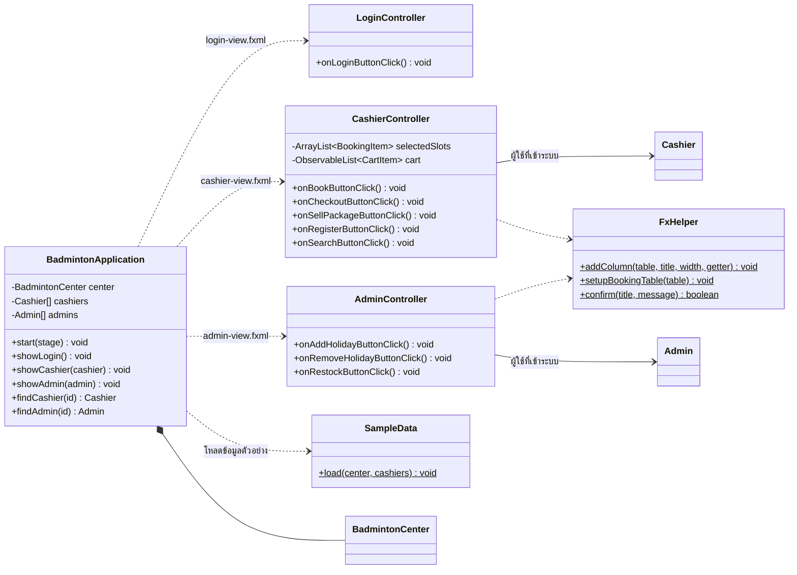

# Class Diagram — ระบบจองสนามแบดมินตัน

เปิดไฟล์นี้บน GitHub จะเห็นเป็นรูปทันที (เขียนด้วย [Mermaid](https://mermaid.js.org/)) ใน IntelliJ ดูได้จาก Markdown preview
ตรงกับโค้ดใน `src/main/java/org/example/badminton` (อัปเดตล่าสุด 2026-10-12)

## 1. คลาสของระบบ (Model)

สัญลักษณ์: `+` public, `-` private, `*` abstract method, `$` static

```mermaid
classDiagram
    direction TB

    class Person {
        <<abstract>>
        -String id
        -String name
        -String phone
        +getId() String
        +getName() String
        +getPhone() String
        +setName(name) void
        +setPhone(phone) void
        +getRole()* String
    }

    class Member {
        +int DISCOUNT_EVERY$
        +int DISCOUNT_PERCENT$
        +int LATE_START_PERCENT$
        -int paidHours
        -HourPackage hourPackage
        -ArrayList~Booking~ bookings
        +getPaidHours() int
        +getPackageHoursLeft() int
        +addBooking(b) void
        +priceItems(items, pricePerHour) double
        +useHours(item) void
        +getTotalBookedHours() int
        +getRole() String
    }

    class Cashier {
        +getRole() String
        +registerMember(center, name, phone) Member
        +bookCourt(center, memberId, courtNo, date, startHour, hours, slipNo, slipFile, slipAmount) Booking
        +bookCourts(center, memberId, requests, slipNo, slipFile, slipAmount) ArrayList~Booking~
        +sellPackage(center, memberId) HourPackage
        +sellItem(center, itemCode, quantity, date, customerName) ItemOrder
        +sellItems(center, cart, date, customerName) ArrayList~ItemOrder~
        +searchBooking(center, keyword) ArrayList~Booking~
        +searchBooking(center, date) ArrayList~Booking~
        +searchBooking(center, courtNo, date) ArrayList~Booking~
    }

    class Admin {
        +String[] CATEGORIES$
        +getRole() String
        +viewBookingHistory(center, memberId) ArrayList~Booking~
        +viewTransactions(center, date) ArrayList~Chargeable~
        +viewTransactions(center, year, month) ArrayList~Chargeable~
        +getDailyRevenue(center, date) double
        +getMonthlyRevenue(center, year, month) double
        +sumTotal(list) double
        +sumCategory(list, category) double
        +addPublicHoliday(center, date) void
        +removePublicHoliday(center, date) void
        +restockItem(center, itemCode, quantity) Item
    }

    class Chargeable {
        <<interface>>
        +String COURT_FEE$
        +String PACKAGE$
        +String RENTAL$
        +String SALE$
        +getTotal() double
        +getDate() LocalDate
        +getCategory() String
    }

    class Booking {
        -String bookingId
        -LocalDate date
        -int startHour
        -int hours
        -LocalDateTime bookedAt
        -boolean lateStart
        -int packageHours
        -int discountHours
        -double courtFee
        -PaymentSlip slip
        +getEndHour() int
        +getTimeText() String
        +overlaps(courtNo, date, startHour, hours) boolean
        +getTotal() double
        +getDate() LocalDate
        +getCategory() String
    }

    class HourPackage {
        +int TOTAL_HOURS$
        +double PRICE$
        -String packageId
        -LocalDate purchaseDate
        -int remainingHours
        +getRemainingHours() int
        +useHours(hours) void
        +getTotal() double
        +getDate() LocalDate
        +getCategory() String
    }

    class ItemOrder {
        -String orderId
        -int quantity
        -LocalDate date
        -String customerName
        -double total
        +getTotal() double
        +getDate() LocalDate
        +getCategory() String
    }

    class Item {
        <<abstract>>
        -String code
        -String name
        -double price
        +calculatePrice(quantity) double
        +getRevenueDate(useDate, today) LocalDate
        +getUnit()* String
        +getCategory()* String
        +isAvailable(quantity, date)* boolean
        +provide(quantity, date)* void
        +getStockInfo(date)* String
        +addStock(quantity)* void
    }

    class RentalItem {
        +double RENTAL_PRICE$
        -int totalPairs
        -HashMap~LocalDate, Integer~ rentedPairs
        +getRentedPairs(date) int
        +getAvailablePairs(date) int
        +isAvailable(quantity, date) boolean
        +provide(quantity, date) void
        +addStock(quantity) void
    }

    class SaleItem {
        -int stock
        +getStock() int
        +isAvailable(quantity, date) boolean
        +provide(quantity, date) void
        +addStock(quantity) void
        +getRevenueDate(useDate, today) LocalDate
    }

    class BookingItem {
        -int courtNo
        -LocalDate date
        -int startHour
        -int hours
        -boolean lateStart
        -int packageHours
        -int discountHours
        -double fee
        +setPrice(packageHours, discountHours, fee) void
        +getCountedHours() int
        +overlaps(other) boolean
    }

    class CartItem {
        -int quantity
        +getSubtotal() double
    }

    class PaymentSlip {
        -String slipNo
        -String fileName
        -double amount
    }

    class Court {
        +double PRICE_PER_HOUR$
        -int courtNo
        +getPricePerHour() double
    }

    class OpeningHours {
        -ArrayList~LocalDate~ publicHolidays
        +addPublicHoliday(date) void
        +removePublicHoliday(date) void
        +isWeekend(date) boolean
        +isHoliday(date) boolean
        +getOpenHour(date) int
        +getOpenHour(holiday) int
        +getCloseHour(date) int
        +getCloseHour(holiday) int
        +isOpen(date, startHour, hours) boolean
        +describe(date) String
    }

    class BadmintonCenter {
        +int COURT_COUNT$
        +int LATE_LIMIT_MINUTES$
        +int MAX_RESTOCK$
        -String name
        -Court[] courts
        -OpeningHours openingHours
        -ArrayList~Member~ members
        -ArrayList~Item~ items
        -ArrayList~Booking~ bookings
        -ArrayList~Chargeable~ transactions
        +isPastTime(date, hour, now) boolean
        +isLateStart(date, hour, now) boolean
        +priceBookings(member, requests, now) double
        +checkBookings(memberId, requests, bookedAt) String
        +checkSlip(slipNo, slipFile, slipAmount, total) String
        +createBookings(cashier, memberId, requests, slipNo, slipFile, slipAmount, bookedAt) ArrayList~Booking~
        +createPackage(memberId, soldAt) HourPackage
        +createItemOrders(cart, date, customerName, now) ArrayList~ItemOrder~
        +restockItem(itemCode, quantity) Item
        +searchBooking(keyword) ArrayList~Booking~
        +findBookingsOutsideHours(date) ArrayList~Booking~
        +getTransactions(date) ArrayList~Chargeable~
        +getTransactions(year, month) ArrayList~Chargeable~
    }

    %% Inheritance
    Person <|-- Member
    Person <|-- Cashier
    Person <|-- Admin
    Item <|-- RentalItem
    Item <|-- SaleItem

    %% Realization (implements)
    Chargeable <|.. Booking
    Chargeable <|.. HourPackage
    Chargeable <|.. ItemOrder

    %% Composition: สร้างขึ้นภายในเจ้าของ และหมดอายุพร้อมเจ้าของ
    BadmintonCenter "1" *-- "12" Court : courts
    BadmintonCenter "1" *-- "1" OpeningHours : openingHours
    Booking "1" *-- "0..1" PaymentSlip : slip

    %% Aggregation: สร้างข้างนอกแล้วส่งเข้ามาเก็บ
    BadmintonCenter "1" o-- "0..*" Member : members
    BadmintonCenter "1" o-- "0..*" Item : items

    %% Association (เส้นไม่มีหัวลูกศร = อ้างอิงถึงกันทั้งสองทาง)
    BadmintonCenter "1" --> "0..*" Booking : bookings
    BadmintonCenter "1" --> "0..*" Chargeable : transactions
    Member "1" -- "0..*" Booking : bookings / member
    Member "1" -- "0..1" HourPackage : hourPackage / member
    Booking "0..*" --> "1" Court : court
    Booking "0..*" --> "1" Cashier : cashier
    ItemOrder "0..*" --> "1" Item : item
    CartItem "0..*" --> "1" Item : item

    %% Dependency: รับเป็น parameter แล้วใช้ ไม่เก็บไว้
    Cashier ..> BadmintonCenter : ใช้งาน
    Admin ..> BadmintonCenter : ใช้งาน
    BadmintonCenter ..> BookingItem : ตรวจ/คิดราคา
    BadmintonCenter ..> CartItem : ตรวจตะกร้า
    Member ..> BookingItem : priceItems
```

## 2. หน้าจอ JavaFX

## 3. หลัก OOP ที่ใช้ในแต่ละความสัมพันธ์

| ความสัมพันธ์ | ในระบบนี้ | อธิบาย |
|---|---|---|
| Inheritance | `Member` / `Cashier` / `Admin` สืบทอด `Person`, `RentalItem` / `SaleItem` สืบทอด `Item` | คลาสลูกได้ id, name, phone หรือ code, name, price จากคลาสแม่ |
| Abstract class | `Person.getRole()`, `Item.isAvailable()` / `provide()` / `addStock()` | คลาสแม่กำหนดว่าต้องมี คลาสลูกเขียนเองเพราะทำงานต่างกัน |
| Interface | `Chargeable` ใช้กับ `Booking` / `HourPackage` / `ItemOrder` | ทุกอย่างที่ทำรายได้ต้องบอกยอดเงิน วันที่ และหมวดได้ |
| Polymorphism | `Admin.sumTotal()` เรียก `getTotal()` ผ่าน `Chargeable`, `restockItem()` เรียก `addStock()` ผ่าน `Item` | เรียกเมธอดเดียวกัน แต่แต่ละคลาสทำงานของตัวเอง |
| Overloading | `searchBooking` 3 แบบ, `viewTransactions` รายวัน/รายเดือน, `getOpenHour(date)` / `getOpenHour(holiday)`, `bookCourt` มี/ไม่มี `bookedAt` | ชื่อเดียวกัน parameter ต่างกัน |
| Composition | `BadmintonCenter` → `Court`, `OpeningHours` / `Booking` → `PaymentSlip` | สร้างใน constructor ของเจ้าของ |
| Aggregation | `BadmintonCenter` → `Member`, `Item` | สร้างข้างนอกแล้วส่งเข้ามาเก็บ |
| Association | `Booking` → `Member`, `Court`, `Cashier` / `ItemOrder` → `Item` | เก็บอ้างอิงถึงอีกคลาสไว้เป็น field |
| Dependency | `Cashier` / `Admin` ..> `BadmintonCenter` | รับเป็น parameter แล้วใช้ ไม่เก็บไว้ |
